# 11. OpenClaw Practical Tutorial

<p id ="anther11.1"></p>

> [!NOTE]
>
> **The robot is shipped with OpenClaw and related packages pre-configured. For the first use, follow Section 11.1 Preparation to import and build. If errors or compatibility issues occur later when running the tutorials, re-import the provided backup resource files and skills to the corresponding paths according to Section 11.1 Preparation and rebuild. After a successful build, proceed with the application tutorials.**

## 11.1 Preparation

Before running any application, move the OpenClaw resource files to the corresponding folders.

1. First, use NoMachine to remotely connect to the robot and enter the system desktop.
2. Drag the **openclaw_resource.zip** file from the [openclaw_resource](https://drive.google.com/drive/folders/1uL-WzVPbn3A41_dq2dZA93nnSt9LJI-y?usp=sharing) folder to the desktop.

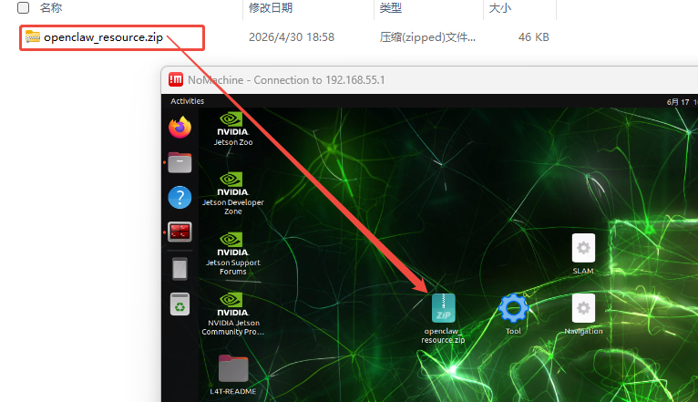

3. Click the command line terminal icon on the left side of the system interface  to start the terminal.
4. Enter the command to extract the file to the corresponding path.

```
unzip ~/Desktop/openclaw_resource.zip -d .
```

5. Enter the command to enter the folder.

```
cd openclaw_resource
```

6. Then enter the command to execute the script.

```
zsh deploy.sh
```

7. In the subsequent options, enter **y** repeatedly.

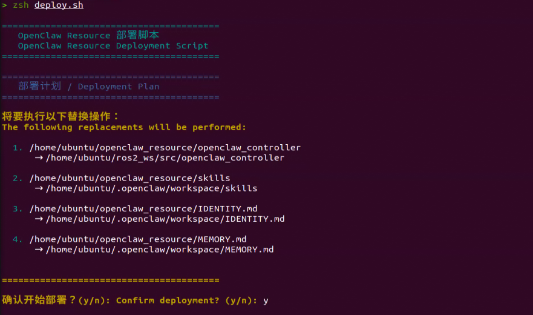

8. After running the script, the previous **IDENTITY.md**, **MEMORY.md**, and three skill backups are saved in the **backup.20260408_111805** folder. use the `ls` command to view them.

9. Then enter the command in the terminal to enter the workspace and build the **openclaw_controller** package.

```
cd ~/ros2_ws/ && colcon build --event-handlers  console_direct+  --cmake-args  -DCMAKE_BUILD_TYPE=Release --symlink-install --packages-select openclaw_controller
```

10. After the build is complete, enter the command to refresh the environment variables.

```
source ~/.zshrc
```

<p id ="anther11.2"></p>

## 11.2 Large Model API-Key Acquisition and Configuration

When using OpenClaw on the robot, first configure the agent model in the Agent. obtain the large model's API-Key and fill it into the corresponding configuration file.

OpenClaw itself supports multiple large models, such as DeepSeek, MiniMax, Qwen, Google, etc. This tutorial uses OpenAI as an example for configuration. If other large models are chosen, search online to obtain the API-Key of that model and configure it in the file.

### 11.2.1 OpenAI Large Model API-Key Acquisition

> [!NOTE]
>
> **This section requires registration on the official OpenAI website to obtain the large model key.**

1) Copy the URL: [https://platform.openai.com/docs/overview](https://platform.openai.com/docs/overview), open the OpenAI webpage, and click Register in the upper right corner.

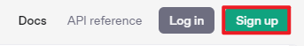

2) Follow the prompts to register and log in using Google, Microsoft, or Apple accounts.

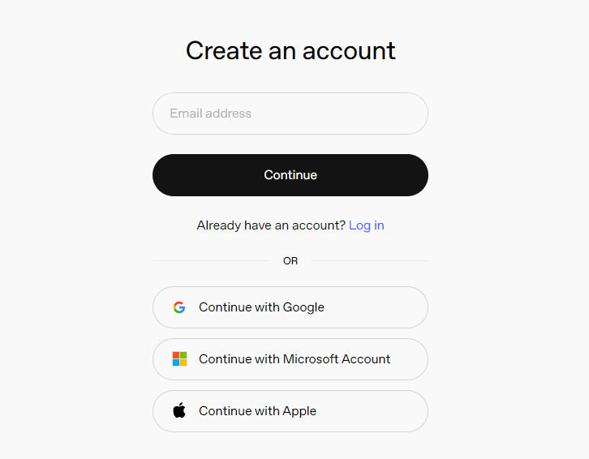

3) Click the Settings button, then click **Billing**, and click **Payment methods** to bind a payment method. Recharge to purchase **tokens**.

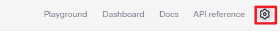

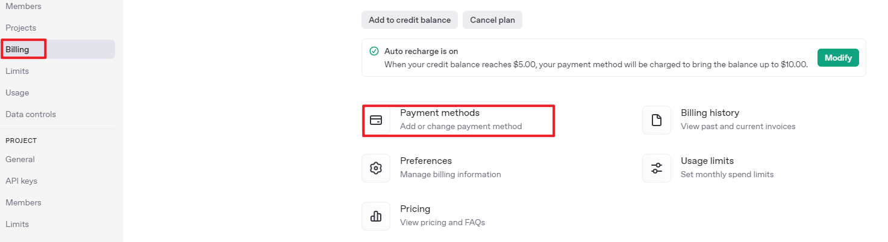

4) After completing the preparations, click **API keys**, click Create new secret key, fill in according to the prompts, and save the key after applying for later use.

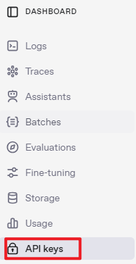

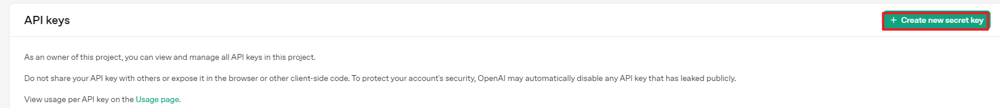

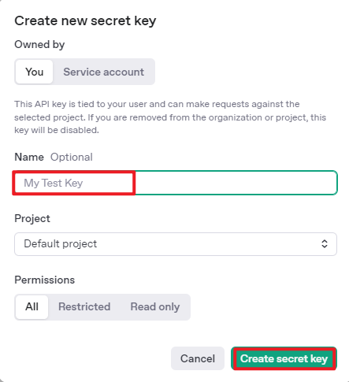

5) At this point, the creation and deployment of the large model is complete. This API will be used in subsequent courses.

### 11.2.2 API Key Configuration

* Virtual Machine Side Operations

1. Click the desktop icon 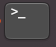 to open the virtual machine system command line terminal.

2. Then enter the command in the command line terminal to configure OpenClaw.

```bash
openclaw config
```

3. Select **Local** and press **Enter**.

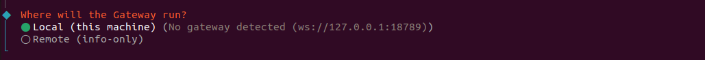

4. Configure **model**. Select **model** and press **Enter**.

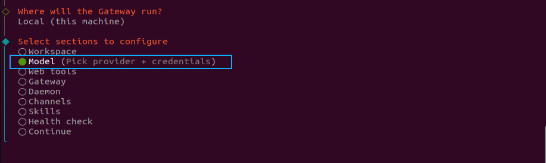

5. Select **OpenAI** and press **Enter**.

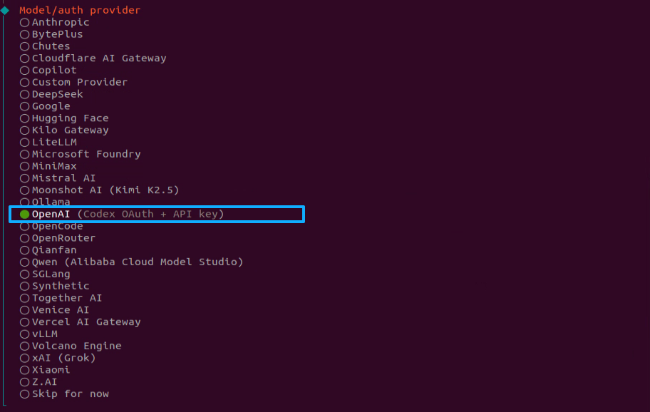

6. Select **OpenAI API key** and press **Enter**.

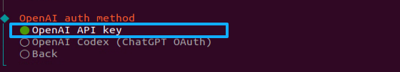

7. Paste the previously copied Key here.

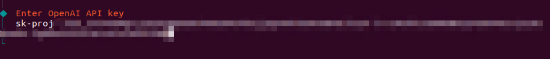

8. Select **openai/gpt-5.4** or another suitable model and press **Enter**.


9. The model configuration is now complete.

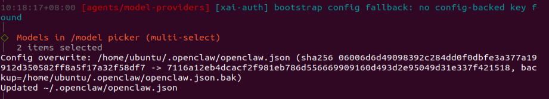

## 11.3 Telegram Application Configuration

### 11.3.1 Configure Telegram

> [!NOTE]
>
> - **Use the Telegram app or the web version for operations. This tutorial uses the web version as an example.**
>- **Make sure there is a Telegram account that can log in normally.**

Telegram web address: [https://web.telegram.org/k/](https://web.telegram.org/k/)

Step 1: Use the app to scan the code or enter the phone number + verification code to log in to Telegram.

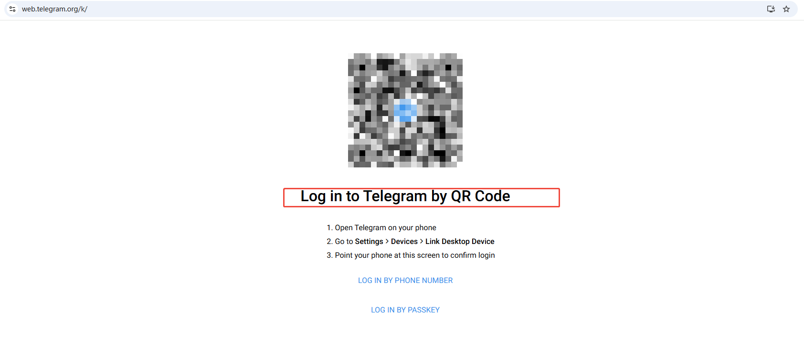

Step 2: Search for BotFather in the search bar in the upper left corner of Telegram, and click the account with official verification as indicated as a blue checkmark to enter the conversation.

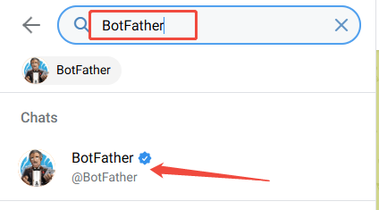

Step 3: Enter and send /newbot in the dialog box to create the Bot and obtain the Token. 

> [!NOTE]
>
> - **The username must end with "_bot".**
> - **After entering, a Token will be received. Keep it properly and do not disclose it. It will be needed for configuration in OpenClaw later.**

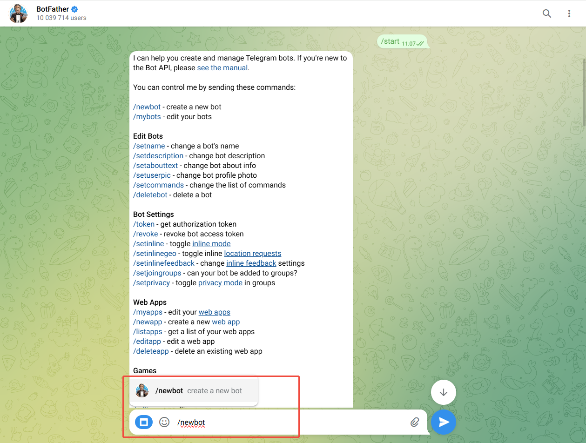

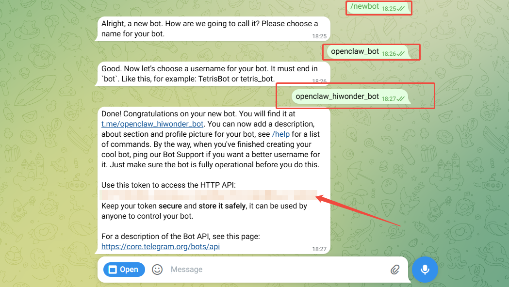

### 11.3.2 OpenClaw Connect to Telegram Plugin

After Telegram preparation is complete, return to the virtual machine to configure OpenClaw.

Step 1: Modify OpenClaw's running configuration (config) to enable the Telegram plugin

```bash
openclaw config set channels.telegram.enabled true
```


Step 2: Write the Telegram bot Token into the OpenClaw configuration

```powershell
openclaw config set channels.telegram.botToken "the TOKEN"
```


Step 3: Start the OpenClaw gateway service

```bash
openclaw gateway
```


Step 4: In the BotFather chat mentioned above, click the position shown in the figure to open the Bot dialog box, and click the START button.

> [!NOTE]
>
> * **Start openclaw gateway in the terminal first, then click START in Telegram, otherwise the pairing code will not be received.**

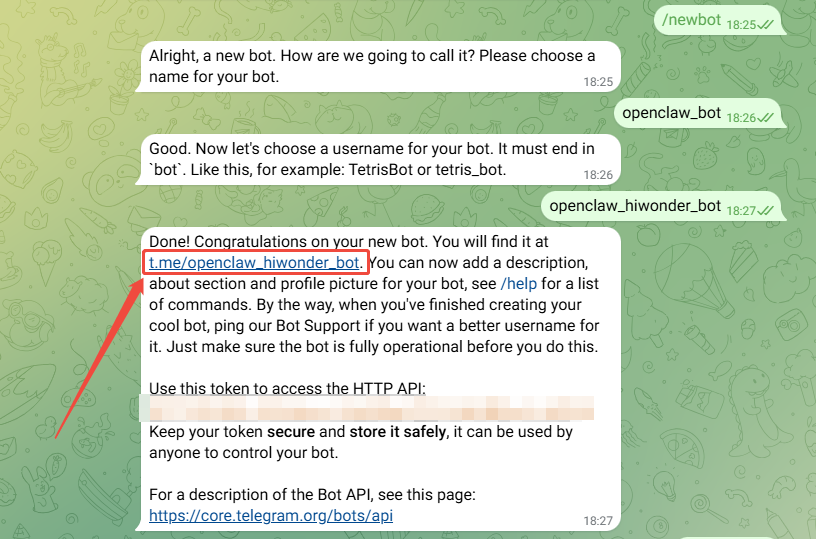

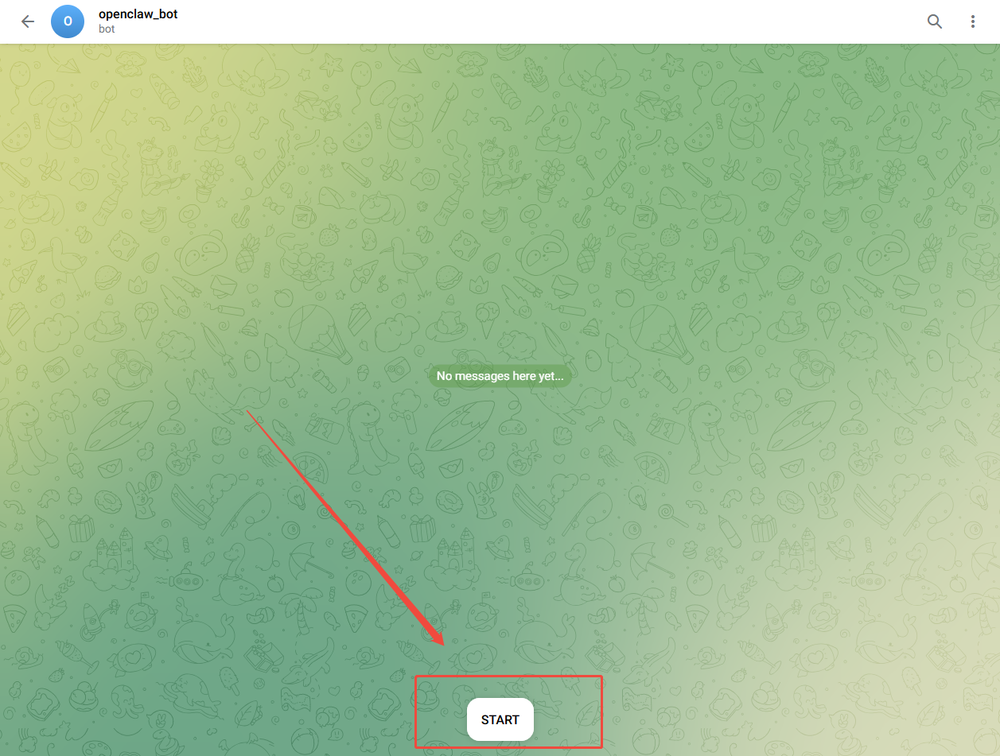

Step 5: On the first conversation, the Telegram Bot will send a pairing code. execute the following command on the server to complete the pairing.

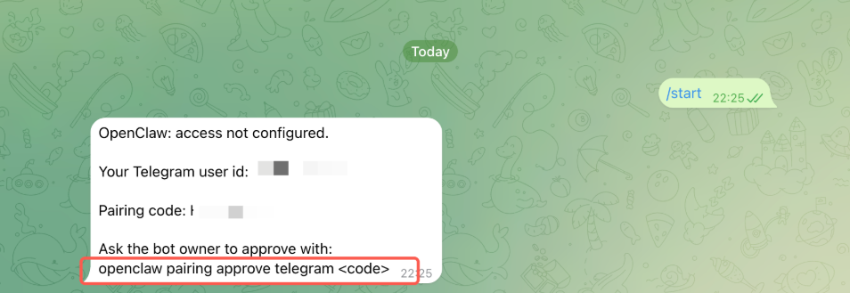

Step 6: Create a new command line terminal and execute the following command. Note: replace `<code>` in the command with the Pairing code received in Telegram. Do not include the `<>` symbols when entering.     

  ```
  openclaw pairing approve telegram <code>
  ```


Step 7: After the command is executed successfully, try chatting with the Bot that has been connected to OpenClaw in Telegram. If the Telegram bot can converse in an AI manner, the OpenClaw connection to Telegram is successfully completed the OpenClaw connection to Telegram.
Then send a minimal test statement in Telegram, such as `hello`.

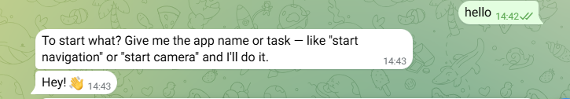

At this point, the deployment of **OpenClaw** connecting to Telegram has been successfully completed.

## 11.4 OpenClaw Basic Features

### 11.4.1 OpenClaw Control Car Movement

After the program starts running, control the robot movement by entering text, for example **move forward for 1 second, move backward for 2 seconds, and finally turn right for 1 second.** Through OpenClaw's skill matching of tasks and skill descriptions, it then sends messages or services according to the instructions to control the car movement. After executing the task, OpenClaw calls the configured large model through the Agent to generate text and reply.

#### 11.4.1.1 Preparation

* **Preparation**

Refer to the tutorial **[1 Tutorial /10.Large AI Language Model Course/10.2 Multimodal Large Model Application](https://wiki.hiwonder.com/projects/ROSOrin/en/jetson-orin-nano-version/docs/10_Large_AI_Model_Courses.html#_10-2-multimodal-large-model-applications)** to configure the OpenAI API_Key.

Refer to the tutorial: [11.1 Preparation](#anther11.1)

* **Configure Large Model API-KEY**

Refer to the tutorial: [11.2 Large Model API-Key Acquisition and Configuration](#anther11.2)

* **Telegram Application Configuration**

Refer to the tutorial: [11.3 Telegram Application Configuration](#anther11.3)

#### 11.4.1.2 Operational Steps

> [!NOTE]
>
> * **Command input must strictly distinguish between uppercase and lowercase letters and spaces.**
>
> * **The robot must be connected to the network, configured in STA (LAN) mode or AP (direct connection) mode with a network cable.**

1. Click the command line terminal icon on the left side of the system interface  to start the terminal.

2. Enter the command to stop the app auto-start service.

```bash
 sudo systemctl stop start_app_node.service
```

3. Enter the command and press **Enter** to start the robot hardware control, which will also start the camera feed.

```
ros2 launch openclaw_controller robot_base_control.launch.py
```

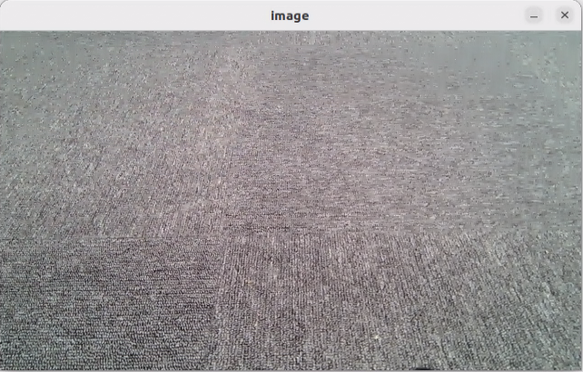

4. Open a new terminal, enter the command, and press **Enter** to start the OpenClaw service. If the service is already started, there is no need to run it again.

```bash
openclaw gateway run
```

5. Open a new terminal, enter the command, and press **Enter** to open the TUI window to send commands.

```
openclaw tui
```

6. Next, enter the command in the TUI window or Telegram chat page: **move forward for 1 second, move backward for 2 seconds** and press **Enter** to control the car movement.

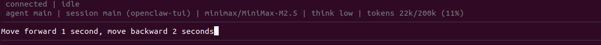

7. After waiting for a period of time, the car will move forward for 1 second, then move backward for 2 seconds, and then generate reply text in the TUI window.

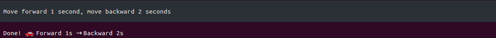

> [!NOTE]
>
> **The answer is automatically generated by the large model. Only the semantic accuracy of the reply is guaranteed, and the text arrangement of the reply is random.**

8. When the TUI window displays the output as shown above, it means that one round of dialogue interaction has ended. Enter a new control command to start the next round of interaction.

9. To experience other basic applications, continue to enter other control commands according to the basic application tutorial. To experience comprehensive applications, press **Ctrl+C** in the last terminal interface opened in step 5 to stop the robot hardware control. If it fails to close, press it multiple times. If it cannot exit, open a new command line terminal and then enter the command to clear ROS nodes.

```bash
~/.stop_ros.sh
```

10. To close the OpenClaw application, press **Ctrl+C** in each terminal interface.

#### 11.4.1.3 Program Outcome

After the application is started, freely organize text and input it into the TUI window or the Telegram chat page on the phone to control the car to move forward, backward, turn left, turn right, and stop.

> [!NOTE]
>
> **The actual running situation will vary depending on different large models, such as the duration of running commands and replies, or the difference between the actual running effect and the command.**

#### 11.4.1.4 Program Analysis

Program path:

**/home/ubuntu/ros2_ws/src/openclaw_controller/openclaw_controller/robot_base_control/claw_move_control.py **

1. Initialize 3 parameters: linear velocity, angular velocity, and stop duration. Create a chassis control node that receives string motion commands, puts the commands into a queue, processes them by a background thread, and finally publishes velocity control messages. It also provides a motion status query service.

```python
        self.default_linear = 0.15
        self.default_angular = 0.45
        self.default_stop_duration = 0.5

        self.cmd_vel_pub = self.create_publisher(Twist, '/controller/cmd_vel', 1)
        self.subscription = self.create_subscription(
            String, '~/chassis_command', self.command_callback, 10)
        self.move_status = 'stop'
        self.create_service(Trigger, '~/move_status', self.move_status_srv_callback)

        self.command_queue = queue.Queue()
        self.client = self.create_client(Trigger, '/init_pose/init_finish')
        self.client.wait_for_service()
        self.worker_thread = threading.Thread(target=self.process_commands, daemon=True)
        self.worker_thread.start()
```

2. When receiving an external request to view the current motion status, this function prints `self.move_status` and returns it through the service response.

```python
    def move_status_srv_callback(self, request, response):
        self.get_logger().info('\033[1;32m Move status: [%s]\033[0m' % self.move_status)
        response.success = True
        response.message = self.move_status
        return response
```

3. This function generates the corresponding chassis velocity control message `Twist` based on the input direction string and updates the robot motion status.

```python
    def parse_twist(self, direction):
        twist = Twist()
        self.move_status = 'moving'
        if direction == 'forward':
            twist.linear.x = self.default_linear
        elif direction == 'backward':
            twist.linear.x = -self.default_linear
        elif direction == 'left':
            twist.linear.x = self.default_linear
            twist.angular.z = self.default_angular
        elif direction == 'right':
            twist.linear.x = self.default_linear
            twist.angular.z = -self.default_angular
        elif direction == 'stop':
            pass
        else:
            return None
        return twist
```

4. This function receives the subscribed string command, cleans and validates it, prints the log, and then puts it into the command queue to wait for the background thread to process.

```python
    def command_callback(self, msg):
        cmd = msg.data.strip()
        if not cmd:
            return
        self.get_logger().info(f'\033[1;34m Command: {cmd}\033[0m')
        self.command_queue.put(cmd)
```

5. This function continuously takes commands to be executed from the command queue and calls the execution function in sequence for processing.

```python
    def process_commands(self):
        while rclpy.ok():
            try:
                cmd = self.command_queue.get(timeout=0.5)
            except queue.Empty:
                continue
            self.execute_command(cmd)
            self.command_queue.task_done()
```

6. This function parses a string compound motion command, executes multiple chassis running actions in sequence, and stops the robot when execution ends or an error occurs.

```python
    def execute_command(self, cmd):
        try:
            cmd = cmd.replace('，', ',')
            parts = [p.strip() for p in cmd.split(',') if p.strip()]
            actions = []
            self.move_status = 'moving'
            for p in parts:
                w = p.split()
                dir = w[0].lower()
                dur = float(w[1]) if len(w) > 1 else self.default_stop_duration
                actions.append((dir, dur))
            
            for i, (dir, dur) in enumerate(actions):
                twist = self.parse_twist(dir)
                if twist is None:
                    self.get_logger().error(f'\033[91mUnknown direction: {dir}\033[0m')
                    self._stop()
                    return
                self.cmd_vel_pub.publish(twist)
                time.sleep(dur)
                if i < len(actions) - 1:
                    self._stop()
                    time.sleep(self.default_stop_duration)
            self._stop()
            self.get_logger().info(f'\033[1;33m Command done\033[0m')
        except Exception as e:
            self.get_logger().error(f'Execution error: {e}')
            self._stop()
```

### 11.4.2 OpenClaw Camera Recognition Feed

After the program starts running, let OpenClaw recognize the current camera feed by entering text and save the photo locally. For example **take a photo, have a look, what is visible.** Through OpenClaw's skill matching of tasks and skill descriptions, it then subscribes to the ROS2 camera image topic according to the instructions. After executing the task, OpenClaw calls the configured large model through the Agent to generate text and reply.

#### 11.4.2.1 Preparation

* **Preparation**

Refer to the tutorial **[1 Tutorial /10 Large AI Model Course/10.2 Multimodal Large Model Application](https://wiki.hiwonder.com/projects/ROSOrin/en/jetson-orin-nano-version/docs/10_Large_AI_Model_Courses.html#_10-2-multimodal-large-model-applications)** to configure the OpenAI API_Key.

Refer to the tutorial: [11.1 Preparation](#anther11.1)

* **Configure Large Model API-KEY**

Refer to the tutorial: [11.2 Large Model API-Key Acquisition and Configuration](#anther11.2)

* **Telegram Application Configuration**

Refer to the tutorial: [11.3 Telegram Application Configuration](#anther11.3)

#### 11.4.2.2 Operational Steps

> [!NOTE]
>
> * **Command input must strictly distinguish between uppercase and lowercase letters and spaces.**
>
> * **The robot must be connected to the network, configured in STA (LAN) mode or AP (direct connection) mode with a network cable.**

1. Click the command line terminal icon on the left side of the system interface  to start the terminal.

2. Enter the command to stop the app auto-start service.

```bash
sudo systemctl stop start_app_node.service
```

3. Enter the command and press **Enter** to start the robot hardware control, which will also start the camera feed.

```
ros2 launch openclaw_controller robot_base_control.launch.py
```

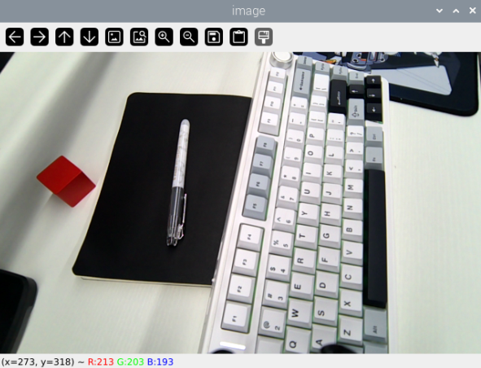

4. Open a new terminal, enter the command, and press **Enter** to start the OpenClaw service. If the service is already started, there is no need to run it again

```bash
openclaw gateway run
```

5. Open a new terminal, enter the command, and press **Enter** to open the TUI window to send commands.

```
openclaw tui
```

6. Next, enter the command in the TUI window or Telegram chat page: **take a picture, tell me what you saw, summarize it for me, and then tell me where you saved it** and press **Enter** to start image recognition.

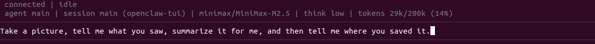

7. After waiting for a period of time, OpenClaw will describe the content of the current image in text form, save the image, and display the storage path.

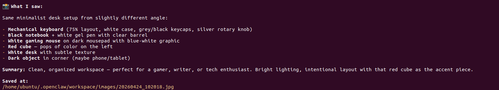

> [!NOTE]
>
> **The answer is automatically generated by the large model. Only the semantic accuracy of the reply is guaranteed, and the text arrangement of the reply is random.**

8. When the TUI window displays the output as shown above, it means that one round of dialogue interaction has ended. Enter a new control command to start the next round of interaction.

9. To experience other basic applications, continue to enter other control commands according to the basic application tutorial. To experience comprehensive applications, press **Ctrl+C** in the last terminal interface opened in step 5 to stop the robot hardware control. If it fails to close, press it multiple times. If it cannot exit, open a new command line terminal and then enter the command to clear ROS nodes.

```bash
~/.stop_ros.sh
```

10. To close the OpenClaw application, press **Ctrl+C** in each terminal interface.

#### 11.4.2.3 Program Outcome

After the application is started, freely organize text and input it into the TUI window or the Telegram chat page on the phone. OpenClaw will describe the content of the current image in text form.

> [!NOTE]
>
> **The actual running situation will vary depending on different large models, such as the duration of running commands and replies, or the difference between the actual running effect and the command.**

## 11.5 OpenClaw Comprehensive Applications

### 11.5.1 OpenClaw + Smart Butler

After the program starts running, control the robot navigation by entering text, for example **take me to the zoo to have a look, what is inside, summarize it for me**. Through OpenClaw's skill matching of tasks and skill descriptions, it then sends messages or services according to the instructions to control the car for navigation. After executing the task, OpenClaw calls the configured large model through the Agent to generate text and reply.

#### 11.5.1.1 Preparation

* **Preparation**

Refer to the tutorial **[1 Tutorial /10. Large AI Model Course/10.2 Multimodal Large Model Application](https://wiki.hiwonder.com/projects/ROSOrin/en/jetson-orin-nano-version/docs/10_Large_AI_Model_Courses.html#_10-2-multimodal-large-model-applications)** to configure the OpenAI API_Key.

Refer to the tutorial: [11.1 Preparation](#anther11.1)

Refer to the tutorial: **[1 Tutorial /5 Mapping and Navigation Course/5.1 Mapping Tutorial and 5.2 Navigation Tutorial](https://wiki.hiwonder.com/projects/ROSOrin/en/jetson-orin-nano-version/docs/5_Mapping_&_Navigation_Course.html)** to build the map.

* **Configure Large Model API-KEY**

Refer to the tutorial: [11.2 Large Model API-Key Acquisition and Configuration](#anther11.2)

* **Telegram Application Configuration**

Refer to the tutorial: [11.3 Telegram Application Configuration](#anther11.3)

<p id ="anther11.5.1.2"></p>

#### 11.5.1.2 Operational Steps

> [!NOTE]
>
> * **Command input must strictly distinguish between uppercase and lowercase letters and spaces.**
>
> * **The robot must be connected to the network, configured in STA (LAN) mode or AP (direct connection) mode with a network cable.**

1. Click the command line terminal icon on the left side of the system interface  to start the terminal.

2. Enter the command to stop the app auto-start service.

```bash
sudo systemctl stop start_app_node.service
```

3. Enter the command and press **Enter** to start the robot hardware navigation function, which will also start the RViz tool.

```
ros2 launch openclaw_controller navigation_manager.launch.py map:=map_01
```

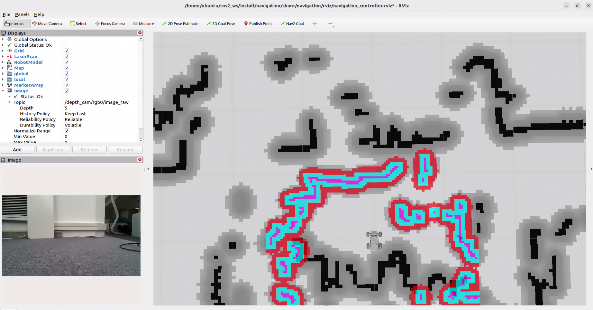

4. Open a new terminal, enter the command, and press **Enter** to start the OpenClaw service. If the service is already started, there is no need to run it again

```bash
openclaw gateway run
```

5. Open a new terminal, enter the command, and press **Enter** to open the TUI window to send commands.

```
openclaw tui
```

6. Next, enter the command in the TUI window or Telegram chat page: **take me to the zoo to have a look, what is inside, summarize it for me** and press **Enter** to start machine navigation.

7. After waiting for a period of time, the machine will navigate to the target point and observe the front, and then generate reply text in the TUI window.

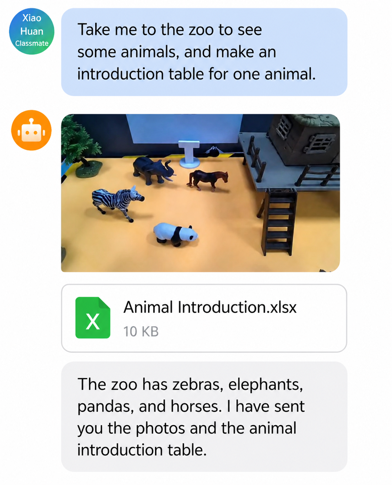

> [!NOTE]
>
> **The answer is automatically generated by the large model. Only the semantic accuracy of the reply is guaranteed, and the text arrangement of the reply is random.**

8. When the TUI window displays the output as shown above, it means that one round of dialogue interaction has ended. Enter a new control command to start the next round of interaction.

9. To experience other basic applications, continue to enter other control commands according to the basic application tutorial. To experience comprehensive applications, press **Ctrl+C** in the last terminal interface opened in step 5 to stop the robot hardware control. If it fails to close, press it multiple times. If it cannot exit, open a new command line terminal and then enter the command to clear ROS nodes.

```bash
~/.stop_ros.sh
```

10. To close the OpenClaw application, press **Ctrl+C** in each terminal interface.

#### 11.5.1.3 Program Outcome

After the application is started, freely organize text and input it into the TUI window or the Telegram chat page on the phone to control the machine for navigation.

> [!NOTE]
>
> **The actual running situation will vary depending on different large models, such as the duration of running commands and replies, or the difference between the actual running effect and the command.**

#### 11.5.1.4 Step-by-Step Debugging

> [!NOTE]
>
> **If OpenClaw does not successfully run the program after entering a text command in the TUI window, enter commands step by step for testing to observe at which step there is an error message.**

1. Click the command line terminal icon on the left side of the system interface  to start the terminal.

2. Enter the command to stop the app auto-start service.

```bash
sudo systemctl stop start_app_node.service
```

3. Start the application:

```
ros2 launch openclaw_controller navigation_manager.launch.py map:=map_01
```

4. Navigate to a certain target point. The data is the location value to be passed in:

```
ros2 service call /claw_navigation_manager/set_pose interfaces/srv/SetString "{data: 'zoo'}"
```

5. Test camera photo:

```
bash -lc '~/.openclaw/workspace/skills/ros2-cam-subscribe/scripts/cam_subscribe.sh --topic /depth_cam/rgb0/image_raw --output-dir /home/ubuntu/.openclaw/workspace/images --timeout 8'
```

#### 11.5.1.5 Navigation Point Modification

1. Click the command line terminal icon on the left side of the system interface  to start the terminal.
2. Enter the command to enter the corresponding path.

```
cd ros2_ws/src/openclaw_controller/config
```

3. Enter the command to edit the yaml file.

```
gedit navigation_position.yaml 
```

4. Only modify the values of the coordinate points `x`, `y` and `yaw`.

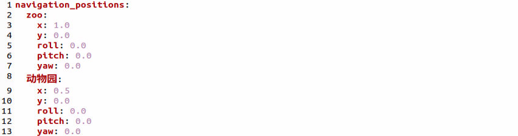

5. After modification, press **Ctrl+s** to save and exit. Then run the application again according to [11.5.1.2 Operational Steps](#anther11.5.1.2).

#### 11.5.1.6 Map Modification

* **Preparation**

> [!NOTE]
>
> Refer to the tutorial: **[1 Tutorial /5 Mapping and Navigation Course/5.1 Mapping Tutorial and 5.2 Navigation Tutorial](https://wiki.hiwonder.com/projects/ROSOrin/en/jetson-orin-nano-version/docs/5_Mapping_&_Navigation_Course.html)** to build the map.

1. Click the command line terminal icon on the left side of the system interface  to start the terminal.
2. Enter the command to enter the corresponding path to view the already built maps.

```
cd ~/ros2_ws/src/slam/maps && ls
```

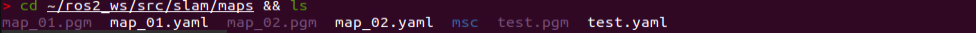

3. The map name here must correspond to the map name saved after mapping. For example, to run the newly created map_02 map, enter the corresponding command in [11.5.1.2 Operational Steps](#anther11.5.1.2) and modify the incoming map name parameter.

```shell
ros2 launch openclaw_controller navigation_manager.launch.py map:=map_02
```

### 11.5.2 OpenClaw + Smart Community

After the program starts running, control the robot navigation by entering text, for example **take me to the park to see what is there**. Through OpenClaw's skill matching of tasks and skill descriptions, it then sends messages or services according to the instructions to control the car for navigation. After executing the task, OpenClaw calls the configured large model through the Agent to generate text and reply.

#### 11.5.2.1 Preparation

* **Preparation**

Refer to the tutorial **[1 Tutorial/10.Large AI Model Course/10.2 Multimodal Large Model Application](https://wiki.hiwonder.com/projects/ROSOrin/en/jetson-orin-nano-version/docs/10_Large_AI_Model_Courses.html#_10-2-multimodal-large-model-applications)** to configure the OpenAI API_Key.

Refer to the tutorial: [11.1 Preparation](#anther11.1)

Refer to the tutorial: **[1 Tutorial /5 Mapping and Navigation Course/5.1 Mapping Tutorial and 5.2 Navigation Tutorial](https://wiki.hiwonder.com/projects/ROSOrin/en/jetson-orin-nano-version/docs/5_Mapping_&_Navigation_Course.html)** to build the map and use road network planning to plan the navigation waypoints.

* **Configure Large Model API-KEY**

Refer to the tutorial: [11.2 Large Model API-Key Acquisition and Configuration](#anther11.2)

* **Telegram Application Configuration**

Refer to the tutorial: [11.3 Telegram Application Configuration](#anther11.3)

<p id ="anther11.5.2.2"></p>

#### 11.5.2.2 Operational Steps

> [!NOTE]
>
> * **Command input must strictly distinguish between uppercase and lowercase letters and spaces.**
>
> * **The robot must be connected to the network, configured in STA (LAN) mode or AP (direct connection) mode with a network cable.**

1. Click the command line terminal icon on the left side of the system interface  to start the terminal.

2. Enter the command to stop the app auto-start service.

```bash
sudo systemctl stop start_app_node.service
```

3. Enter the command and press **Enter** to start the robot hardware navigation function, which will also start the RViz tool.

```bash
ros2 launch openclaw_controller smart_scene_navigation.launch.py  navigation_mode:="smart_community" road_network_map:="road_network_community"
```

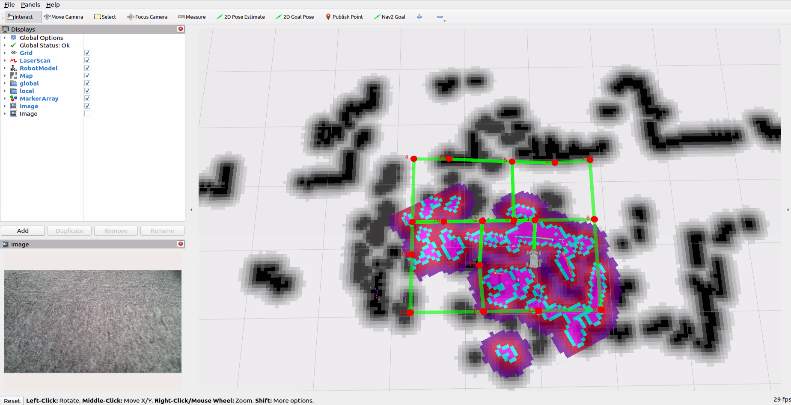

4. Open a new terminal, enter the command, and press **Enter** to start the OpenClaw service. If the service is already started, there is no need to run it again.

```bash
openclaw gateway run
```

5. Open a new terminal, enter the command, and press **Enter** to open the TUI window to send commands.

```
openclaw tui
```

6. Next, enter the command in the TUI window or Telegram chat page: **take me to the park to see what is there** and press **Enter** to start machine navigation.

7. After waiting for a period of time, the machine will navigate to the target point and observe the front, and then generate reply text in the TUI window.

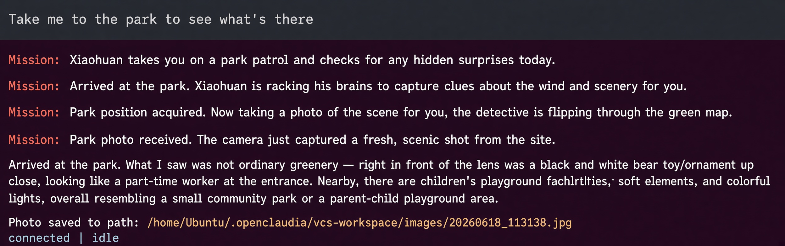

> [!NOTE]
>
> **The answer is automatically generated by the large model. Only the semantic accuracy of the reply is guaranteed, and the text arrangement of the reply is random.**

8. When the TUI window displays the output as shown above, it means that one round of dialogue interaction has ended. Enter a new control command to start the next round of interaction.

9. To experience other basic applications, continue to enter other control commands according to the basic application tutorial. To experience comprehensive applications, press **Ctrl+C** in the last terminal interface opened in step 5 to stop the robot hardware control. If it fails to close, press it multiple times. If it cannot exit, open a new command line terminal and then enter the command to clear ROS nodes.

```bash
~/.stop_ros.sh
```

10. To close the OpenClaw application, press **Ctrl+C** in each terminal interface.

#### 11.5.2.3 Program Outcome

After the application is started, freely organize text and input it into the TUI window or the Telegram chat page on the phone to control the machine for navigation.

> [!NOTE]
>
> **The actual running situation will vary depending on different large models, such as the duration of running commands and replies, or the difference between the actual running effect and the command.**

#### 11.5.2.4 Step-by-Step Debugging

> [!NOTE]
>
> **If OpenClaw does not successfully run the program after entering a text command in the TUI window, enter commands step by step for testing to observe at which step there is an error message.**

1. Click the command line terminal icon on the left side of the system interface  to start the terminal.

2. Enter the command to stop the app auto-start service.

```bash
sudo systemctl stop start_app_node.service
```

3. Start the application:

```bash
ros2 launch openclaw_controller smart_scene_navigation.launch.py  navigation_mode:="smart_community" road_network_map:="road_network_community"
```

4. Enter the command to query navigable navigation points and id numbers.

```
ros2 service call /claw_navigation_manager/list_positions std_srvs/srv/Trigger {}
```

5. Publish the navigation point according to the queried id to navigate to the express station. The data is the id value of the express station to be passed in:

```
ros2 topic pub /request_waypoint std_msgs/msg/Int32 "data: 1" --once
```

6. Publish the navigation point according to the queried id to navigate to the supermarket. The data is the id value of the supermarket to be passed in:

```
ros2 topic pub /request_waypoint std_msgs/msg/Int32 "data: 1" --once
```

#### 11.5.2.5 Navigation Point Modification

> [!NOTE]
>
> **The id of the modified navigation point must be consistent with the path point sequence id of the road network planning.**

1. Click the command line terminal icon on the left side of the system interface  to start the terminal.
2. Enter the command to enter the corresponding path.

```
cd ros2_ws/src/openclaw_controller/config
```

3. Enter the command to edit the yaml file.

```
gedit smart_community.yaml 
```

4. Only modify the id of the coordinate points.

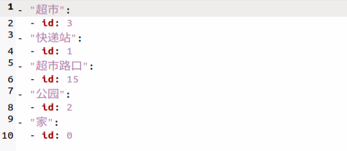

5. After modification, press **Ctrl+S** to save and exit. Then run the application again according to [11.5.2.2 Operational Steps](#anther11.5.2.2).

#### 11.5.2.6 Road Network Modification

> [!NOTE]
>
> **When only small adjustments to the position or pose of existing path points are needed, directly modify the .yaml file.**

* **Make fine adjustments according to the position coordinates and pose of the points corresponding to the id**.

1. Click the desktop icon  to open the command line terminal. Enter the command to stop the app auto-start service:

```
sudo systemctl stop start_app_node.service
```

2. Enter the command to enter the specified directory.

```
cd ~/ros2_ws/src/large_models_examples/large_models_examples/road_network/config
```

3. Open the yaml file of the corresponding community road network.

```
gedit road_network_community.yaml
```

4. Make small adjustments to the position or pose of existing path points according to the actual situation.

> **id: The number of each path point in the road network**
>
> **pose: [x, y, theta]: That is, the spatial pose of the robot at this node, which is two-dimensional plane coordinates + heading angle.**
>
> **to: The ID list of other path points that the current path point can directly reach**

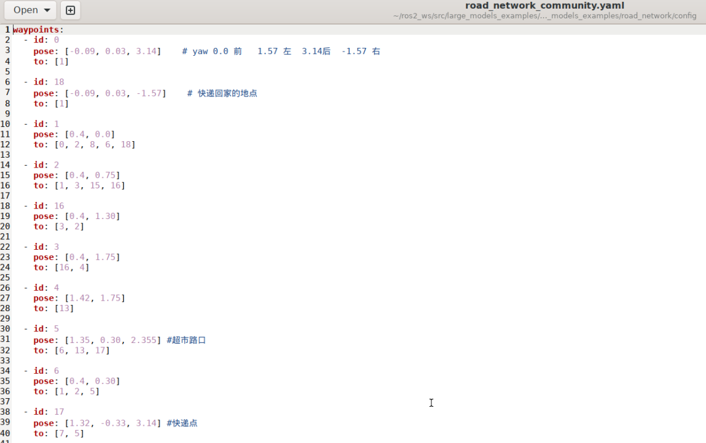

5. After modification, press **Ctrl+S** to save and exit. Then run the application again according to [11.5.2.2 Operational Steps](#anther11.5.2.2).
